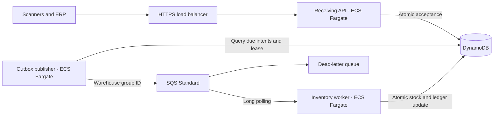

# AWS Warehouse Intake

**A working multi-warehouse receiving backend with DynamoDB, SQS and ECS/Fargate, without Lambda.** Receive serialized products or bulk quantities, track processing, and query inventory through an authenticated HTTP API.

The repository includes the API, durable outbox publisher, inventory worker, local environment, integration tests, OpenAPI contract, load runner and CloudFormation deployment. The receiving workflow runs locally end to end. Capacity above 100,000 units/day is a sizing objective to measure in the deployment environment; local tests do not establish AWS throughput.

## Features

- Serialized units and bulk SKU quantities with optional lot codes.
- Organization and warehouse access from verified JWTs; administrator catalog management.
- Atomic acceptance and durable publication intent before returning `202`.
- Protection against repeated HTTP requests, business references and queue deliveries.
- Serial-number uniqueness across warehouses within one organization.
- Entry status, paginated receiving history and consistent inventory queries.
- Recoverable publisher leases, worker visibility heartbeats and a dead-letter queue.

This version covers **incoming stock**. Transfers, shipments and adjustments require separate audited movement types; see [next improvements](docs/roadmap.md).

## Architecture



One container image runs three independent roles. SQS delivery is at least once; conditional DynamoDB transactions enforce one stock effect per movement. Standard-queue warehouse groups enable AWS fair-queue scheduling without global FIFO ordering. See [architecture](docs/architecture.md) and [data model](docs/data-model.md).

## Run locally

Install Node.js 24 and Docker with Compose. From PowerShell:

```powershell
git clone https://github.com/helberjf/aws-warehouse-intake.git
cd aws-warehouse-intake
Copy-Item .env.example .env
npm ci
npm run check
docker compose up -d --build
Invoke-RestMethod http://localhost:3000/ready
```

Compose creates a disposable DynamoDB/SQS environment, organization `DEMO`, warehouses `WH-01`/`WH-02`, and products `BULK-001`/`SERIAL-001`. It uses no AWS account or credentials. Wait for readiness before making requests. The API and emulator bind only to localhost.

Receive a bulk movement:

```powershell
$token = node --env-file=.env scripts/local-token.ts
$headers = @{ Authorization = "Bearer $token"; 'Idempotency-Key' = 'delivery-001-line-1' }
$body = @{
  mode = 'BULK'; skuId = 'BULK-001'; quantity = 100; lotCode = 'LOT-2026-001'
  externalReference = 'delivery-001-line-1'; occurredAt = '2026-11-05T12:00:00Z'
} | ConvertTo-Json
$entry = Invoke-RestMethod -Method Post -Uri http://localhost:3000/warehouses/WH-01/receiving-entries -Headers $headers -ContentType application/json -Body $body
Invoke-RestMethod -Uri "http://localhost:3000/warehouses/WH-01/receiving-entries/$($entry.entryId)" -Headers $headers
Invoke-RestMethod -Uri http://localhost:3000/warehouses/WH-01/stock/BULK-001 -Headers $headers
```

`ACCEPTED` means durably recorded; `APPLIED` means stock changed; `REJECTED` means a business rule prevented the change. Exact retries are safe. Different data under the same key or business reference returns `409`. Local tokens expire after one hour.

The [OpenAPI contract](schemas/openapi.json) is also served at `/openapi.json`. [API documentation](docs/api.md) describes authentication and endpoints. Production requires RS256 tokens from a configured HTTPS JWKS provider and rejects local signing secrets.

## Verify and measure

```powershell
npm run check
npm run test:integration
npm run test:load -- --count 1000 --concurrency 10
npm run capacity -- --daily-units 100000 --serialized-share 1 --active-hours 8 --peak-factor 30 --warehouses 5
```

Tests cover authentication, warehouse isolation, concurrent acceptance, conflicting references, serial uniqueness, atomic stock, ambiguous acknowledgements, lease recovery, visibility heartbeats and poison-message redrive. CI runs checks, integration tests, dependency audit, infrastructure lint and container build.

The load runner mixes serialized and bulk movements, sends HTTP replays, concentrates 80% of traffic in one warehouse, waits for every entry to become applied, and reconciles expected stock. See [validation evidence](docs/validation.md) and [capacity planning](docs/capacity.md).

**100,000 units are not necessarily 100,000 movements.** Serialized intake means about 3.47 movements/second over eight hours; bulk movements can group many units. Peak traffic and hot SKUs determine task sizing.

## Deploy and operate

[Deployment](docs/deployment.md) covers image publication, CloudFormation, private networking, identity configuration, alarms, scaling, rollback and recovery. The production template takes an existing VPC, ACM certificate and identity provider. It includes HTTPS, separate IAM roles, retained DynamoDB data with point-in-time recovery, encrypted queues and API/worker autoscaling.

No AWS deployment runs automatically. Services, load balancing, networking, telemetry and retained data incur charges after deployment. [Operations](docs/operations.md) covers DLQ recovery and reconciliation.

Stop the disposable local environment with `docker compose down`.

## Repository guide

| Path                               | Purpose                                 |
| ---------------------------------- | --------------------------------------- |
| [src/http](src/http)               | HTTP API and JWT authorization          |
| [src/storage](src/storage)         | DynamoDB transactions, leases and stock |
| [src/processing](src/processing)   | Queue publication and consumption       |
| [src/domain](src/domain)           | Validation and deterministic identities |
| [integration](integration)         | Emulator transaction and queue tests    |
| [infra](infra)                     | CloudFormation application and registry |
| [docs/roadmap.md](docs/roadmap.md) | Next improvements                       |
