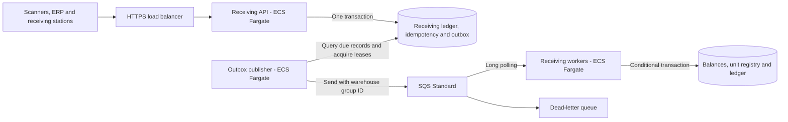

# AWS Warehouse Intake

**Multi-warehouse product receiving with DynamoDB, SQS and ECS/Fargate, without AWS Lambda.** The design supports individually serialized products and bulk receiving by SKU and quantity, with a planning target above 100,000 physical units per day.

This first revision provides executable TypeScript domain contracts, a generated JSON Schema, request examples, automated tests and a capacity calculator. The container services and AWS deployment described below are the target architecture; the repository does not yet run a receiving API or modify inventory in AWS.

## Receiving models

| Mode         | Meaning of one entry                                                | Example                                      |
| ------------ | ------------------------------------------------------------------- | -------------------------------------------- |
| `SERIALIZED` | One uniquely identified unit; quantity is derived as 1              | One scanner with a serial number             |
| `BULK`       | One movement containing a quantity of one SKU, with an optional lot | 100 boxes received against one delivery line |

The product catalog determines the permitted tracking mode. A client cannot bypass serial-number control by submitting a serialized SKU as bulk. Warehouse permissions and organization identity come from validated access context, not ownership fields supplied in the body.

**A physical unit, a receiving movement and a queue message are different quantities.** One bulk movement can contain many units; retries can produce multiple deliveries of one message. See [capacity planning](docs/capacity.md).

## Target architecture



The API, outbox publisher and receiving workers have independent scaling and IAM roles. The publisher is a continuously running container process, so neither Lambda nor a Lambda-triggered stream is required. [Architecture decisions](docs/architecture.md) explain consistency, failure recovery and warehouse isolation.

## Domain foundation

- Strict request validation for serialized and bulk entries, including catalog tracking-mode checks.
- Stable business entry IDs independent of HTTP retry keys.
- Scoped idempotency keys and normalized payload hashes for conflict detection.
- Serialized-unit keys shared across warehouses within one organization.
- Per-warehouse `MessageGroupId` values for the proposed SQS fair-queue configuration.
- Capacity calculations that distinguish physical units from receiving movements.

These helpers prepare validated commands; persistence adapters must enforce the documented DynamoDB conditions before any stock update. They are not an authentication service or an exactly-once transport guarantee.

## Run the foundation locally

Prerequisites: Node.js 24 and npm. No AWS credentials or containers are needed for these checks.

```bash
git clone https://github.com/helberjf/aws-warehouse-intake.git
cd aws-warehouse-intake
npm ci
npm run check
npm run capacity -- --daily-units 100000 --serialized-share 1 --active-hours 8 --peak-factor 30 --warehouses 5
```

The capacity command prints an arrival-rate estimate, not a benchmark or a task-count recommendation. With all units serialized, 100,000 units/day corresponds to about 1.16 movements/second over 24 hours, or 3.47 during an eight-hour operating window. A hypothetical 30-times burst in that window is about 104 movements/second across all warehouses.

## Request examples

The proposed endpoint is `POST /warehouses/{warehouseId}/receiving-entries` with a required `Idempotency-Key` header. The acceptance response is `202`; completion is asynchronous. These endpoints are design contracts for the implementation roadmap.

See [serialized entry](examples/serialized-entry.json), [bulk entry](examples/bulk-entry.json) and the generated [JSON Schema](schemas/receiving-entry.schema.json). `externalReference` identifies one physical receiving movement and must remain stable across retries, including retries with a new HTTP key. Partial receipts need distinct movement references.

## Repository guide

| Location                                   | Purpose                                                 |
| ------------------------------------------ | ------------------------------------------------------- |
| [Domain contract](src/domain/receiving.ts) | Validation, catalog checks and deterministic identities |
| [Capacity model](src/planning/capacity.ts) | Reproducible workload assumptions and arrival rates     |
| [Data model](docs/data-model.md)           | Proposed keys, transactions and stock invariants        |
| [Architecture](docs/architecture.md)       | Container topology, queue processing and recovery       |
| [Capacity planning](docs/capacity.md)      | Peak scenarios, load-test targets and cost drivers      |
| [Implementation roadmap](docs/roadmap.md)  | Ordered increments and acceptance evidence              |

## Validation

Run `npm run check` for TypeScript strict checking, formatting, domain/capacity tests and schema consistency. The tests cover request contracts, deterministic identities and planning arithmetic; they do not exercise DynamoDB, SQS, ECS or a deployed API. Capacity above 100,000 units/day is a design objective to validate with representative load tests.

Recorded locally on 2026-11-04: **25 tests passed**, TypeScript and formatting checks passed, the generated schema matched the source contract, and npm audit reported zero known vulnerabilities.

## Implementation roadmap

1. Build the receiving API with warehouse authorization, DynamoDB transactions and status lookup.
2. Implement the durable outbox publisher and idempotent SQS worker as container processes.
3. Provision ECS/Fargate, queues, tables, IAM and observability with CloudFormation.
4. Exercise duplicates, competing stock updates, worker crashes, DLQ recovery and warehouse fairness.
5. Measure sustained load, burst recovery and cost before choosing production task counts and limits.

No AWS resources are provisioned by the current repository. Deployment sizing and recurring costs will be reviewed before infrastructure creation.
