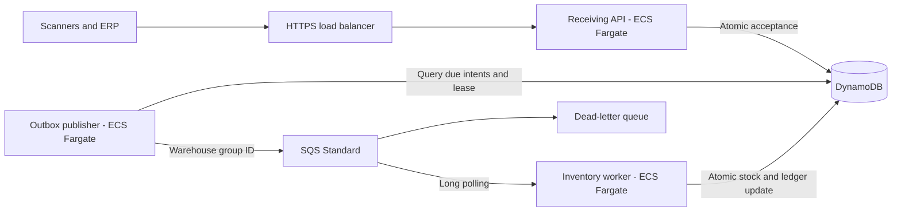

# AWS Warehouse Intake

**A multi-warehouse receiving application with a Portuguese web console, DynamoDB, SQS and ECS/Fargate, without Lambda.** Sign in, register products, scan barcodes, receive stock and inspect each warehouse. Product creators and receiving operators are recorded automatically from authenticated identity.

The repository includes the responsive frontend, password/session authentication, API, durable outbox publisher, inventory worker, local environment, integration tests, OpenAPI contract, load runner and CloudFormation deployment. The receiving workflow runs locally end to end. Capacity above 100,000 units/day is a sizing objective to measure in the deployment environment; local tests do not establish AWS throughput.

## Features

- Username/password login, password changes, secure sessions and warehouse permissions.
- Responsive product, receiving and stock screens in Portuguese.
- Camera or USB/Bluetooth barcode lookup with automatic product, time and reference fields.
- Immutable product-creator attribution and receiving-operator history.
- Serialized units and bulk SKU quantities with optional lot codes.
- Organization and warehouse access from browser sessions or optional verified machine JWTs; administrator catalog management.
- Atomic acceptance and durable publication intent before returning `202`.
- Protection against repeated HTTP requests, business references and queue deliveries.
- Serial-number uniqueness across warehouses within one organization.
- Entry status, paginated receiving history and consistent inventory queries.
- Recoverable publisher leases, worker visibility heartbeats and a dead-letter queue.

This version covers **incoming stock**. Transfers, shipments and adjustments require separate audited movement types; see [next improvements](docs/roadmap.md).

## Architecture



One container image runs three independent roles. SQS delivery is at least once; conditional DynamoDB transactions enforce one stock effect per movement. Standard-queue warehouse groups enable AWS fair-queue scheduling without global FIFO ordering. See [architecture](docs/architecture.md) and [data model](docs/data-model.md).

## Publish frontend on Vercel

The repository includes a **static, read-only demonstration** with 16 fictional warehouses, 8 products, example stock/history and camera or USB barcode lookup. It requires no AWS account, environment variables, username or password. Product registration, receiving submissions and real authentication are disabled; demonstration data is not persisted.

Import this repository into Vercel. The committed configuration selects **Other**, installs with `npm ci`, builds with `npm run build:frontend`, and publishes only `dist/frontend`, using Node.js 24. Preview it locally with `npm ci` followed by `npm run preview:frontend`, then open http://127.0.0.1:4173. See the [Vercel guide](docs/vercel.md) for deployment steps, browser tests and the future AWS connection requirements.

This configuration does not deploy the AWS backend or establish a live Vercel URL. The connected Docker application below retains real login and receiving behavior.

## Run locally

Install Node.js 24 and Docker with Compose. From PowerShell:

```powershell
git clone https://github.com/helberjf/aws-warehouse-intake.git
cd aws-warehouse-intake
npm ci
npm run local:configure
npm run check
docker compose up -d --build
Invoke-RestMethod http://localhost:3000/ready
```

Compose creates a disposable DynamoDB/SQS environment, organization `DEMO`, warehouses `WH-01`/`WH-02`, and products `BULK-001`/`SERIAL-001`. It uses no AWS account or credentials. Wait for readiness before making requests. The API and emulator bind only to localhost.

**Open http://localhost:3000.** The local organization is `DEMO`; the user is `admin` unless configured otherwise. A random local password is generated by `local:configure` and saved only in ignored `.env` and `.tokens/local-login.txt`. Read that private file to sign in; no default password is committed. Use the Products screen to register a SKU and barcode, then Entries to scan and confirm receiving. [Browser and account guide](docs/browser.md).

For machine API usage, receive a bulk movement:

```powershell
$token = node --env-file=.env scripts/local-token.ts
$headers = @{ Authorization = "Bearer $token"; 'Idempotency-Key' = 'delivery-001-line-1' }
$body = @{
  mode = 'BULK'; skuId = 'BULK-001'; quantity = 100; lotCode = 'LOT-2026-001'
  externalReference = 'delivery-001-line-1'; occurredAt = '2026-11-05T12:00:00Z'
} | ConvertTo-Json
$entry = Invoke-RestMethod -Method Post -Uri http://localhost:3000/warehouses/WH-01/receiving-entries -Headers $headers -ContentType application/json -Body $body
Invoke-RestMethod -Uri "http://localhost:3000/warehouses/WH-01/receiving-entries/$($entry.entryId)" -Headers $headers
Invoke-RestMethod -Uri http://localhost:3000/warehouses/WH-01/stock/BULK-001 -Headers $headers
```

`ACCEPTED` means durably recorded; `APPLIED` means stock changed; `REJECTED` means a business rule prevented the change. Exact retries are safe. Different data under the same key or business reference returns `409`. Local tokens expire after one hour.

The [OpenAPI contract](schemas/openapi.json) is also served at `/openapi.json`. [API documentation](docs/api.md) describes authentication and endpoints. Browser sessions use provisioned username/password accounts. Optional bearer integrations require RS256 tokens from a configured HTTPS JWKS provider. Production requires an exact HTTPS public origin and rejects local signing secrets.

## Test data

Run `npm run demo:seed` after starting the local stack to add 16 synthetic warehouses across Brazil, 8 products, 48 receipts and two additional test accounts. Generated passwords are saved only in ignored `.tokens/dados-de-teste.txt`. The manager `gestor.teste` accesses all 16 warehouses; `operador.teste` receives/queries only WH-01/WH-02. Both use organization `DEMO`.

Open http://localhost:3000/demo-barcodes.html for eight printable barcode labels. [Test-data guide](docs/test-data.md) lists the codes, expected balances and scenarios. Re-running the seed preserves account credentials and stock identities.

## Verify and measure

```powershell
npm run check
npm run test:integration
npx playwright install chromium
npm run test:e2e
npm run test:load -- --count 1000 --concurrency 10
npm run capacity -- --daily-units 100000 --serialized-share 1 --active-hours 8 --peak-factor 30 --warehouses 16
```

Tests cover authentication, warehouse isolation, concurrent acceptance, conflicting references, serial uniqueness, atomic stock, ambiguous acknowledgements, lease recovery, visibility heartbeats and poison-message redrive. CI runs checks, integration tests, dependency audit, infrastructure lint and container build.

The load runner mixes serialized and bulk movements, sends HTTP replays, concentrates 80% of traffic in one warehouse, waits for every entry to become applied, and reconciles expected stock. See [validation evidence](docs/validation.md) and [capacity planning](docs/capacity.md).

The dedicated `npm run test:load:warehouses` runner tests individually serialized packages across 16 warehouses with real browser sessions, isolated data and exact reconciliation. It supports fixed arrival rates, bounded concurrency and uneven warehouse traffic. See the [16-warehouse measurements](docs/load-16-warehouses.md), including the separate outbox/unit audit.

**100,000 units are not necessarily 100,000 movements.** Serialized intake means about 3.47 movements/second over eight hours; bulk movements can group many units. Peak traffic and hot SKUs determine task sizing.

## Deploy and operate

The [cost study](docs/cost-study.md) estimates **100,000 packages/day in total across 16 warehouses**, using one shared São Paulo deployment. It includes the browser workflow, authentication, audit history, DynamoDB, SQS, Fargate, networking and monitoring, with separate startup and month-12 storage estimates. Regional AWS rates and assumptions are recorded in the repository. Recalculate with `npm run costs` or `npm run costs -- --scenario ha --month 12`; this makes no AWS calls.

[Deployment](docs/deployment.md) covers image publication, CloudFormation, private networking, identity configuration, alarms, scaling, rollback and recovery. The production template takes an existing VPC, ACM certificate and public HTTPS origin; an external JWT provider is optional for machine integrations. It includes HTTPS, separate IAM roles, retained DynamoDB data with point-in-time recovery, encrypted queues and API/worker autoscaling.

No AWS deployment runs automatically. Services, load balancing, networking, telemetry and retained data incur charges after deployment. [Operations](docs/operations.md) covers DLQ recovery and reconciliation.

Stop the disposable local environment with `docker compose down`.

## Repository guide

| Path                               | Purpose                                             |
| ---------------------------------- | --------------------------------------------------- |
| [public](public)                   | Browser console and barcode reader                  |
| [src/identity](src/identity)       | Password hashing, sessions and account provisioning |
| [src/http](src/http)               | HTTP API and JWT authorization                      |
| [src/storage](src/storage)         | DynamoDB transactions, leases and stock             |
| [src/processing](src/processing)   | Queue publication and consumption                   |
| [src/domain](src/domain)           | Validation and deterministic identities             |
| [integration](integration)         | Emulator transaction and queue tests                |
| [infra](infra)                     | CloudFormation application and registry             |
| [docs/roadmap.md](docs/roadmap.md) | Next improvements                                   |
